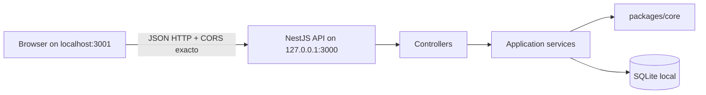
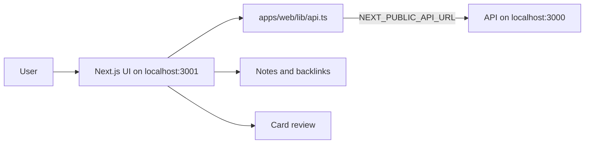

# Markdown Study MVP

## Arquitectura

Es un monorepo npm con tres workspaces: `packages/core` contiene la lógica de dominio compartida, `apps/api` expone la API HTTP y `apps/web` contiene la interfaz Next.js.

### Backend



### Frontend



El navegador solo conoce el contrato HTTP. La API valida la forma mínima de los cuerpos antes de entrar a los servicios; la lógica de wikilinks, plantillas seguras y scheduler vive en `packages/core`. SQLite guarda notas, links, plantillas, tarjetas y reviews en una tabla por entidad dentro de un archivo local.

## Flujo de datos

1. El usuario crea o actualiza una nota desde Next.js.
2. `apps/web/lib/api.ts` envía JSON a `apps/api`.
3. El controlador valida que el body sea un objeto y delega al servicio.
4. El servicio usa `packages/core` para normalizar títulos, extraer wikilinks o validar/renderizar plantillas.
5. El repositorio persiste el resultado en SQLite. Una actualización de nota reemplaza contenido y links en una sola transacción.
6. La API devuelve JSON; la interfaz refresca notas, backlinks o la cola de repaso.

## Demo local

Desde la raíz, después de `npm install`:

```bash
npm run build
npm test
```

Levanta los procesos en terminales separadas, para que el orquestador pueda cerrarlos de forma independiente:

```bash
npm run dev:api
npm run dev:web
```

También existe `npm run dev` para ejecutar ambos procesos desde un shell compatible y limpiar el proceso de API al salir. Los puertos son explícitos:

- API: `http://127.0.0.1:3000` (`PORT` y `HOST` son configurables).
- Web: `http://localhost:3001`.
- CORS de API: `WEB_ORIGIN`, por defecto `http://localhost:3001`; se permite un origen exacto, no `*`.
- Web: `NEXT_PUBLIC_API_URL`, por defecto `http://localhost:3000`.
- SQLite: `SQLITE_PATH`, por defecto `./data/app.sqlite`; se crea el directorio padre para rutas locales. `:memory:` sigue disponible para tests.

El build raíz compila explícitamente `packages/core` antes de `apps/api`, por lo que funciona en un checkout sin `dist` generado.

## Contrato HTTP implementado

Todos los cuerpos de escritura deben ser objetos JSON. Un body `null`, ausente o que sea un array devuelve `422` con `{ "message": "body must be an object" }` antes de acceder a los servicios.

| Método y ruta | Body / resultado |
|---|---|
| `POST /notes` | `{ title, content }` → nota creada |
| `GET /notes` | Lista de notas |
| `GET /notes/:id` | Una nota |
| `PUT /notes/:id` | `{ content }` → nota actualizada y sus links reemplazados atómicamente |
| `GET /notes/:id/backlinks` | Backlinks de la nota |
| `POST /templates` | `{ name, fields, frontHtml, backHtml, css }` → plantilla |
| `GET /templates` | Lista de plantillas |
| `PUT /templates/:id` | Definición completa de plantilla → plantilla actualizada |
| `POST /render` | `{ templateId, fields, side }` o `{ template, fields, side }` → `{ srcdoc }` seguro |
| `POST /cards` | `{ templateId, fields, sourceNoteId? }` → tarjeta |
| `GET /cards` | Lista de tarjetas |
| `GET /cards/:id` | Una tarjeta |
| `GET /review/queue` | Tarjetas pendientes, máximo 20 |
| `POST /review/:cardId` | `{ rating: "again" | "hard" | "good" | "easy" }` → tarjeta revisada |
| `POST /dev/clock` | Solo fuera de production: `{ offsetDays }` → hora simulada |

Los errores de validación son `422`, conflictos de unicidad `409`, recursos ausentes `404` y errores no controlados `500`. `/dev/clock` responde `404` cuando `NODE_ENV=production` y no forma parte del flujo de la demo normal.

## Decisiones KISS y alcance

- Un único repositorio SQLite local, sin ORM ni capa de configuración adicional.
- Validación mínima en los controladores y validación de dominio en servicios/core.
- Un cliente HTTP pequeño en el frontend; no se introduce una librería de estado global.
- El build/test raíz usa comandos explícitos para que el orden entre workspaces sea visible.
- El MVP cubre notas Markdown, wikilinks/backlinks, plantillas seguras, creación de tarjetas y repaso simplificado.
- No se implementan login, tags, búsqueda, grafo, sincronización ni backend remoto.

## Riesgos conocidos

- SQLite local es adecuado para la demo y un único proceso, pero no resuelve concurrencia o despliegue multiinstancia.
- No hay autenticación/autorización; no debe exponerse la API fuera de una red confiable.
- El origen CORS es único y configurable; cambiarlo requiere reiniciar la API.
- El endpoint de reloj existe únicamente para pruebas/demo fuera de production.
